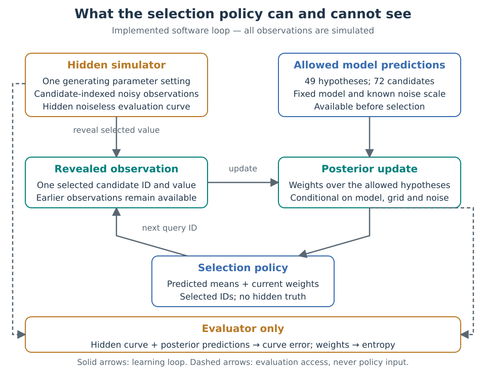
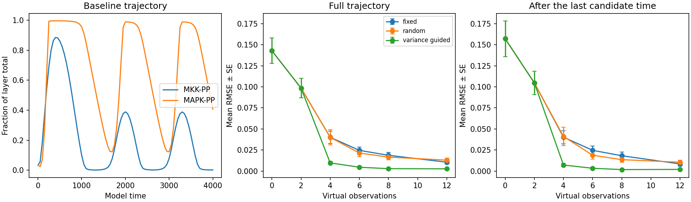
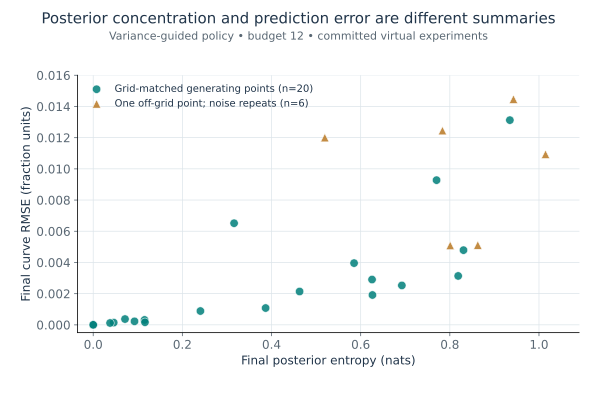

# MAPK dynamics lab

Give three selection rules the same budget of 12 simulated observations of a signaling pathway. One queries the readout and time where the remaining models disagree most. The others follow a fixed schedule or choose at random. Compare how closely each rule predicts the hidden trajectory, including the interval after the final opportunity to observe it.

The published model links three kinase layers, including mitogen-activated protein kinase (MAPK). A kinase adds a phosphate group to a target. See the [biology guide](docs/biology-and-concepts.md) for the model and its assumptions.

## Why this project

This is the third featured study in [From biological measurements to better experiments](https://github.com/TheThunda01/TheThunda01/blob/main/PROJECT_GUIDE.md): moving from what a model can explain to which observation could distinguish its remaining hypotheses.

Several parameter settings can produce similar time courses. The small feedback model published by Kholodenko lets you compare selection rules across many simulated trajectories on an ordinary computer. Each policy sees only the observations it selects. The evaluator has the complete simulated trajectory, as Figure 1 shows. The results describe this simulation. [Original model](https://pubmed.ncbi.nlm.nih.gov/10712587/)



**Figure 1. Data access in the virtual measurement loop.** This is a software schematic, not laboratory automation. It follows [the implemented experiment](mapk_lab/experiment.py); the [methods table](docs/methods.md#finite-hypotheses-and-virtual-observations) gives the corresponding inputs and limits. The [figure builder](tools/build_documentation_figures.py) writes only documentation assets.

## What it does

- Verifies an offline BioModels snapshot released under CC0, an upstream public-domain dedication, and translates its eight species and ten reaction rates.
- Checks conserved totals, nonnegative trajectories, source MathML rates, tighter solver tolerances, and a separately written five-state formulation.
- Provides an optional COPASI import and baseline cross-engine comparison, with a native model, aligned species tables and explicit numerical acceptance checks.
- Compares three policies across 20 matched-model seeds, with 49 parameter hypotheses, 72 available observations and a 12-observation budget.
- Adds six off-grid noise repeats to expose the limits of a finite hypothesis set.
- Exports observations, selections, full posterior weights (updated probabilities over the allowed hypotheses), prediction tables and metrics, then independently replays the likelihood and acquisition calculations.

## Quick start

Use Python 3.11 or later, from the repository root:

```bash
python -m venv .venv
source .venv/bin/activate
python -m pip install -r requirements.txt
python scripts/run_benchmark.py --out .reproduction
python scripts/verify_results.py --results-dir .reproduction
python scripts/compare_results.py results .reproduction
python -m unittest discover -s tests -v
```

The Markdown report is written as UTF-8, including on systems with a different default text encoding.

The benchmark needs no network after dependencies are installed. The default run
takes under a minute in the development environment; runtime varies by machine.
Use `--seeds 2 --grid-size 3` for a smaller exploration. Those flags change the
experiment, so that run should not match the committed reference tables.

## Example results

After 12 observations, the variance-guided rule predicted the unqueried late interval with a mean root mean squared error (RMSE) of 0.002009, compared with 0.008488 for the fixed schedule. These errors use the same 20 simulated trajectories. Select budget 12 in the [summary table](results/summary.csv) or inspect individual seeds in the [trial table](results/trials.csv).

**Table 1. Mean final curve error in the matched-model simulation.**

| Selection rule | Full curve RMSE | Late-window RMSE |
|---|---:|---:|
| Variance guided | 0.002679 | 0.002009 |
| Fixed schedule | 0.010577 | 0.008488 |
| Random schedule | 0.012998 | 0.010517 |



**Figure 2. Simulated dynamics and the matched-model policy comparison.** Sources: [baseline trajectory](results/baseline_trajectory.csv) and [trial summaries](results/summary.csv). Error bars are descriptive standard errors across computational seeds, not independent biological replicates. The [full report](results/report.md) defines the evaluation scope.

Both outputs are fractions of their kinase-layer totals. All policies share the
same first two observations and, within a seed, the same candidate-indexed noise.
Budget zero is the uniform prior: equal weights before any observations. Full curve RMSE covers both readouts at 81 times, including points that policies can query. Late-window RMSE uses the eight unqueryable times from 3650 through 4000. Both columns average per-seed RMSE.
See the [paired-seed plot](results/paired_final_rmse.png) and [full trials](results/trials.csv).

The separate [COPASI comparison](docs/copasi-comparison.md) checks the same baseline model through another importer and integration engine. All 648 concentration comparisons passed the declared 0.002 nM absolute criterion; the maximum difference was about 0.00005 nM. This is numerical agreement, not additional biological evidence.

In the off-grid check, the variance-guided rule had mean final RMSE 0.010007 and
entropy 0.820690 nats. Entropy measures how dispersed the weights are; nats use
natural logarithms. The generating point lies between allowed points but inside
both parameter ranges, so this check tests finite-grid resolution, not
out-of-range extrapolation.

Concentrated weights cannot add an excluded generating point to the hypothesis grid.
These examples support a bounded simulation comparison, not a general claim
that this rule is best.

Figure 3 compares final prediction error with posterior entropy for the variance-guided policy. Entropy describes how concentrated the hypothesis weights are; prediction error describes how close their averaged prediction is to the hidden simulated curve.



**Figure 3. Concentrated weights and accurate predictions are different summaries.** Sources: budget-12 rows from [matched-model trials](results/trials.csv) and [off-grid trials](results/stress_trials.csv), with exact input hashes in the [figure manifest](docs/figures/figure-manifest.json). Each point is a computational run. The groups use different generating settings, so their contrast does not isolate a causal effect of grid mismatch. No fitted trend or significance test is shown.

## Practical use and limitations

Use this project to test virtual observation-selection logic and audit a small
ordinary differential equation (ODE) translation. ODEs describe how modeled
quantities change over time.

The selection rule scores posterior-weighted variance of the latent (noiseless)
predicted mean, **not exact expected information gain**. The analysis assumes
normally distributed (Gaussian) noise, constant totals and a uniform grid prior.
Only two parameters vary; the others remain fixed.

The compact model omits explicit kinase–substrate complexes.
[Blüthgen et al. (2006)](https://pubmed.ncbi.nlm.nih.gov/16478465/) showed that
sequestration (binding into complexes) can alter the ultrasensitivity (a steep response to input) and oscillations (repeated temporal changes) predicted by this
model class. A numerically stable simulation is not experimental validation.
Read the [worked use case and checks](docs/practical-use.md) before adapting it.

## Documentation

The [21 October 2026 maintenance and scientific review](docs/review-2026-10-21.md) records the latest checks and their limits. Earlier review records remain available below.

- [Project context](docs/project-context.md) — background, rationale and main themes
- [Biology and concepts](docs/biology-and-concepts.md) — the cascade, feedback and identifiability
- [Methods](docs/methods.md) — equations, design, metrics and numerical checks
- [Practical use](docs/practical-use.md) — inputs, outputs, failures and a worked example
- [Literature review](docs/literature-review.md), [search log](docs/search-log.json) and [references](docs/references.md)
- [Provenance and related tools](docs/provenance-and-tools.md) — exact source, license and reuse boundaries

Definitions and interpretation: [glossary](docs/glossary.md), [assumptions](docs/assumptions.md), [reference audit](docs/reference-audit.json) and [dated review](docs/review-2026-10-20.md).

## Development and reuse

`mapk_lab/model.py` implements the model-specific translation;
`mapk_lab/experiment.py` separates acquisition from hidden-truth evaluation.
The verifier independently computes posterior likelihoods and metrics from CSVs.
Continuous integration (CI) runs tests, reruns the full experiment and compares every CSV numerically.

Original code is [MIT licensed](LICENSE). The encoded model remains
[CC0 with upstream attribution](DATA_LICENSE.md). No third-party application
implementation was copied. Please include model and method citations when using
the scientific ideas, and disclose changes to the hypothesis grid, noise or budget.

Rebuild Figures 1 and 3 with `python tools/build_documentation_figures.py`. The builder reads committed CSV files and writes `docs/figures/`; it does not rerun the model or replace analysis outputs.
