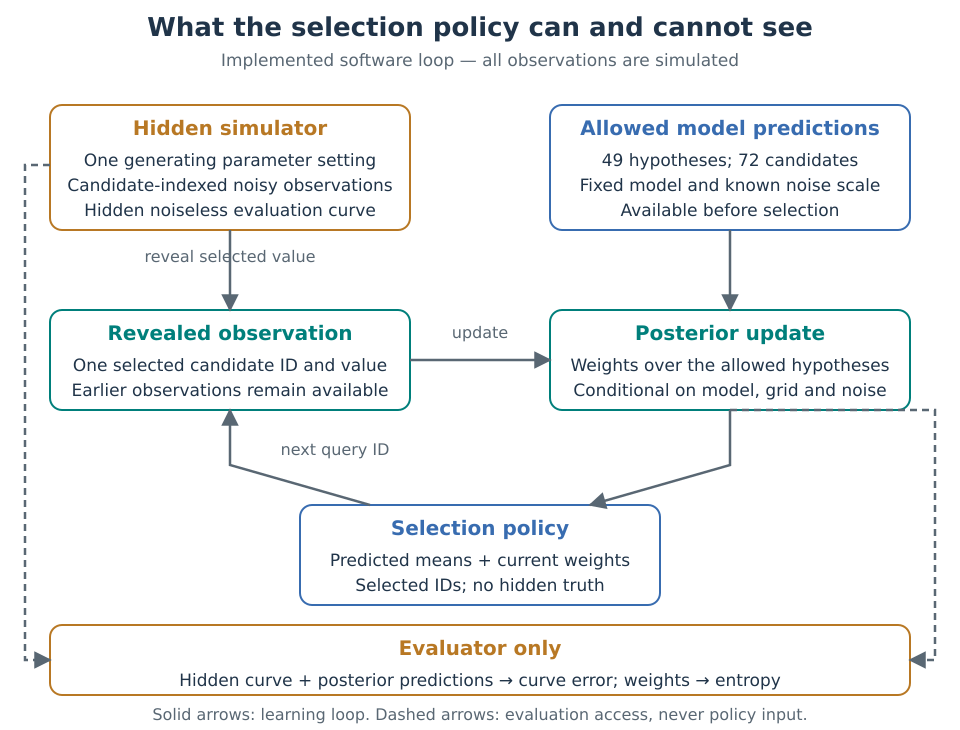
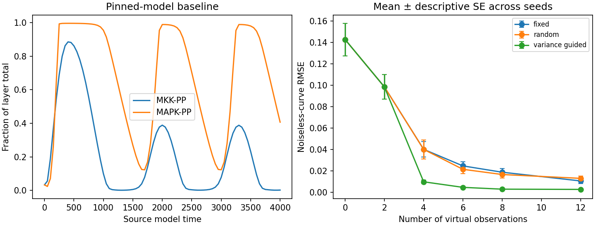
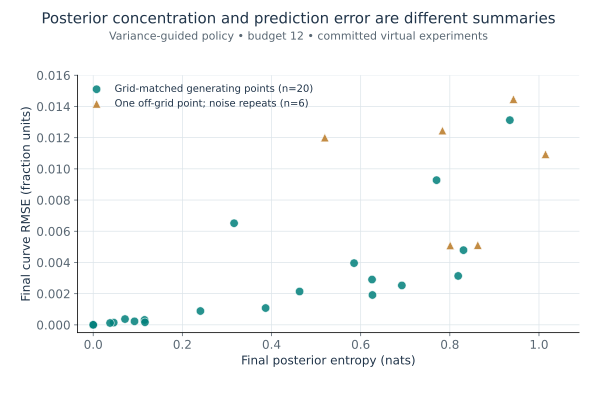

# MAPK dynamics lab

Which simulated observations help distinguish hypotheses about a signaling pathway?
MAPK means mitogen-activated protein kinase, one layer of a signaling cascade. A kinase adds a phosphate group to a target; this model links three kinase layers. This repository turns a small, published MAPK model into an inspectable experiment:
simulate a hidden parameter setting, choose a measurement, update the hypotheses,
and repeat. It compares a variance-guided rule with random and fixed schedules.

Start with the [project context](docs/project-context.md) for the motivation or
[biology and concepts](docs/biology-and-concepts.md) for a fuller explanation.

## Why this project

A time course can look plausible while leaving several parameter explanations
open. Choosing another observation is therefore part of the scientific problem.
The [Kholodenko (2000) model](https://pubmed.ncbi.nlm.nih.gov/10712587/) is small enough
to inspect and rich enough to show feedback-dependent dynamics. Its compactness
also makes it possible to check the numerical implementation and compare repeated
virtual experiments on an ordinary computer.

The goal is to evaluate a decision rule under stated assumptions. This project
does not collect laboratory data, reproduce an original-paper figure, or establish
that the model captures a particular cell's behavior.

Figure 1 shows what closes the implemented loop and which information is reserved for evaluation. Keeping those routes separate prevents the policy from choosing an observation using its hidden answer.



**Figure 1. Data access in the virtual measurement loop.** This is a software schematic, not laboratory automation. It follows [the implemented experiment](mapk_lab/experiment.py); the [methods table](docs/methods.md#finite-hypotheses-and-virtual-observations) gives the corresponding inputs and limits. The [figure builder](tools/build_documentation_figures.py) writes only documentation assets.

## What it does

- Verifies an offline BioModels snapshot released under CC0, an upstream public-domain dedication, and translates its eight species and ten reaction rates.
- Checks conserved totals, nonnegative trajectories, source MathML rates, tighter solver tolerances, and a separately written five-state formulation.
- Compares three policies across 20 matched-model seeds, with 49 parameter hypotheses, 72 available observations and a 12-observation budget.
- Adds six off-grid noise repeats to expose the limits of a finite hypothesis set.
- Exports observations, selections, full posterior weights (updated probabilities over the allowed hypotheses), prediction tables and metrics, then independently replays the likelihood and acquisition calculations.

## Quick start

Use Python 3.11 or later, from the repository root:

```bash
python -m venv .venv
source .venv/bin/activate
python -m pip install -r requirements.txt
python scripts/run_benchmark.py --out .reproduction
python scripts/verify_results.py --results-dir .reproduction
python scripts/compare_results.py results .reproduction
python -m unittest discover -s tests -v
```

The benchmark needs no network after dependencies are installed. The default run
takes under a minute in the development environment; runtime varies by machine.
Use `--seeds 2 --grid-size 3` for a smaller exploration. Those flags change the
experiment, so that run should not match the committed reference tables.

## Example results

The committed [report](results/report.md) is computed from actual runs. At budget
12, mean noiseless-curve root mean squared error (RMSE) across the 20 matched-model seeds was as shown in Table 1.

**Table 1. Mean final curve error in the matched-model simulation.**

| Selection rule | Mean RMSE |
|---|---:|
| Variance guided | 0.002679 |
| Fixed schedule | 0.010577 |
| Random schedule | 0.012998 |



**Figure 2. Simulated dynamics and the matched-model policy comparison.** Sources: [baseline trajectory](results/baseline_trajectory.csv) and [trial summaries](results/summary.csv). Error bars are descriptive standard errors across computational seeds, not independent biological replicates. The [full report](results/report.md) defines the evaluation scope.

Both outputs are fractions of their kinase-layer totals. All policies share the
same first two observations and, within a seed, the same candidate-indexed noise.
Budget zero is the uniform prior: equal weights before any observations. The RMSE covers 81 times, including queried
points and an unqueried late interval; it is not a purely held-out error estimate.
See the [paired-seed plot](results/paired_final_rmse.png) and [full trials](results/trials.csv).

In the off-grid check, the variance-guided rule had mean final RMSE 0.010007 and
entropy 0.820690 nats, a measure of weight dispersion using natural logarithms. The generating point is between allowed points but inside both parameter ranges; this tests finite-grid resolution, not out-of-range extrapolation. Concentrating weight among allowed hypotheses cannot make
a missing generating point available. These examples support a bounded simulation
comparison, not a general claim that this rule is best.

Figure 3 places final prediction error next to posterior entropy for the variance-guided policy. It helps distinguish two questions: how concentrated the allowed hypotheses are, and how close their averaged prediction is to the hidden simulated curve.



**Figure 3. Concentrated weights and accurate predictions are different summaries.** Sources: budget-12 rows from [matched-model trials](results/trials.csv) and [off-grid trials](results/stress_trials.csv), with exact input hashes in the [figure manifest](docs/figures/figure-manifest.json). Each point is a computational run. The groups use different generating settings, so their contrast does not isolate a causal effect of grid mismatch. No fitted trend or significance test is shown.

## Practical use and limitations

This is a starting point for testing virtual observation-selection logic and
auditing a small ordinary differential equation (ODE) translation. ODEs describe how modeled quantities change over time. The adaptive score is posterior-weighted
variance of the latent (noiseless) predicted mean, **not exact expected information gain**.
The normally distributed (Gaussian) noise, constant totals, two varying parameters and uniform grid prior
are choices made here. Most model parameters remain fixed.

The compact model omits explicit kinase–substrate complexes.
[Blüthgen et al. (2006)](https://pubmed.ncbi.nlm.nih.gov/16478465/) showed that
sequestration (binding into complexes) can alter the ultrasensitivity (a steep response to input) and oscillations (repeated temporal changes) predicted by this
model class. A numerically stable simulation is not experimental validation.
Read the [worked use case and checks](docs/practical-use.md) before adapting it.

## Documentation

- [Project context](docs/project-context.md) — background, rationale and main themes
- [Biology and concepts](docs/biology-and-concepts.md) — the cascade, feedback and identifiability
- [Methods](docs/methods.md) — equations, design, metrics and numerical checks
- [Practical use](docs/practical-use.md) — inputs, outputs, failures and a worked example
- [Literature review](docs/literature-review.md), [search log](docs/search-log.json) and [references](docs/references.md)
- [Provenance and related tools](docs/provenance-and-tools.md) — exact source, license and reuse boundaries

Definitions and interpretation: [glossary](docs/glossary.md), [assumptions](docs/assumptions.md), [reference audit](docs/reference-audit.json) and [dated review](docs/review-2026-10-20.md).

## Development and reuse

`mapk_lab/model.py` implements the model-specific translation;
`mapk_lab/experiment.py` separates acquisition from hidden-truth evaluation.
The verifier independently computes posterior likelihoods and metrics from CSVs.
Continuous integration (CI) runs tests, reruns the full experiment and compares every CSV numerically.

Original code is [MIT licensed](LICENSE). The encoded model remains
[CC0 with upstream attribution](DATA_LICENSE.md). No third-party application
implementation was copied. Please include model and method citations when using
the scientific ideas, and disclose changes to the hypothesis grid, noise or budget.

Rebuild Figures 1 and 3 with `python tools/build_documentation_figures.py`. The builder reads committed CSV files and writes `docs/figures/`; it does not rerun the model or replace analysis outputs.
