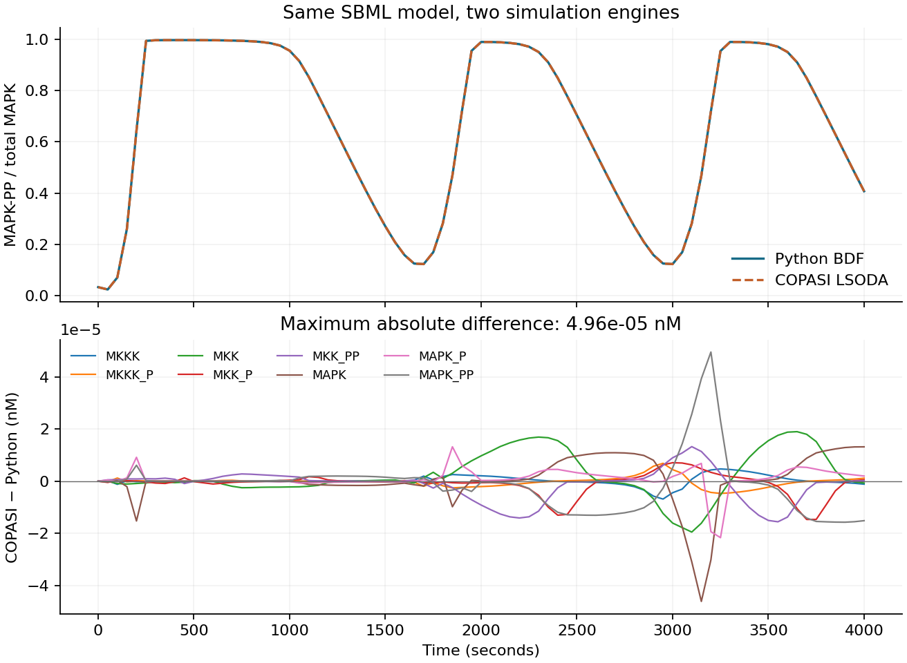

# An optional COPASI cross-engine check

The unchanged, fingerprint-checked BioModels SBML can now run in COPASI as well as the project's Python translation. This checks whether two simulation engines produce compatible baseline concentrations for the same encoded equations, initial state and parameter values.

## Reproduce the comparison

Install the repository's pinned Python dependencies and obtain [COPASI from its official release page](https://copasi.org/Download/). The recorded run used **COPASI 4.48, Build 311**. COPASI is optional and is not installed by `requirements.txt` or required for the normal benchmark.

```bash
python scripts/compare_copasi.py --copasi /path/to/CopasiSE --out .reproduction-copasi
```

On Windows, quote the complete path to `CopasiSE.exe`. Choose a **new output directory**: existing directories and paths inside `data/` or `results/` are rejected before COPASI runs. The command writes a native `baseline.cps` model, a full-precision COPASI table, a species-aligned comparison table, a figure and a verification JSON. Open the CPS file in COPASI to inspect its reactions and the configured Time-Course task. Its report target is relative to that file; manually rerunning the native task replaces `copasi-trajectory.tsv` in that output location. Git attributes preserve the exact native CPS/TSV bytes used by the recorded hashes.

The script verifies the source hashes before import. It sets a regular grid of 81 points from 0 through 4,000 seconds, baseline `v1_scale=1` and `ki=9`, and requests concentrations in the original SBML species-ID order. COPASI's display names differ from the Python names; the script follows COPASI's explicit SBML-ID mapping rather than guessing by name or position. Concentrations are in nmol/litre (nM).

## What passed

The [recorded comparison](../examples/copasi-comparison/verification.json) uses COPASI LSODA with relative/absolute tolerances `1e-10`/`1e-12`, and the existing Python BDF settings `1e-8`/`1e-10`. Across 648 concentration pairs, the maximum absolute difference was **about 0.00005 nM**, below the predeclared **0.002 nM** criterion already used by this project's solver checks. Initial states matched exactly; the largest COPASI layer-total deviation was about `1.25e-12 nM` and concentrations remained nonnegative.



The upper panel compares the same MAPK-PP fraction. The lower panel expands their small numerical differences; its scale is concentrations, not a biological effect size. See [every comparison](../examples/copasi-comparison/comparison.csv) and [native model](../examples/copasi-comparison/baseline.cps). Output hashes and software versions are retained in the verification record.

## Scope and failure handling

This adds a separate model importer and LSODA integration implementation. It does not supply independent biological data, validate the finite-hypothesis observation policy, reproduce the original article's figures, or test every alternative parameter setting. Both engines still solve the same curated model.

Malformed/nonfinite trajectories, unequal time grids, changed initial values, negative concentrations, failed conservation, or differences above the declared threshold prevent a passing result. Exit 0 means the comparison passed; exit 1 means a completed comparison failed; exit 2 means the comparison could not be completed. Unit tests exercise failure cases without requiring COPASI. The external comparison must be run separately when changing the model or its translation.

COPASI's [command-line documentation](https://copasi.org/Support/User_Manual/) and the installed `CopasiSE --help` describe model import and task execution. Native output was produced by COPASI; the comparison script, figure and checks were written for this repository with AI assistance. The imported model retains the original [CC0 provenance](provenance-and-tools.md).
